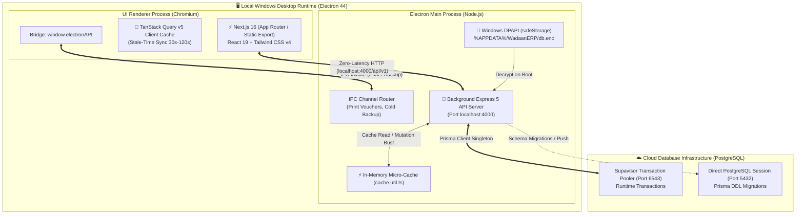
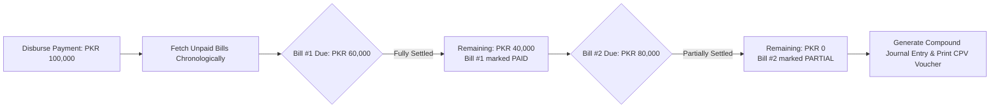

# 🏢 Wadaan Real Estate & Builders ERP

<div align="center">


**A high-precision, local-first enterprise desktop ERP and double-entry financial core engineered specifically for real estate developers, construction builders, and property brokerage firms.**

[-0078D6?style=flat-square&logo=windows)](https://github.com/jalal1122/Wadaan-Real-Estate-And-Builder-ERP-System)
[](https://www.electronjs.org/)
[](https://nextjs.org/)
[](https://react.dev/)
[](https://www.typescriptlang.org/)
[](https://expressjs.com/)
[](https://www.prisma.io/)
[](https://supabase.com/)
[](https://tailwindcss.com/)
[-059669?style=flat-square)](https://github.com/MikeMcl/decimal.js/)
[]()
[]()

[Architecture Overview](#-system-architecture--topology) •
[Core Modules](#-comprehensive-screen--module-matrix) •
[Financial & Domain Engines](#-financial--domain-engineering-invariants) •
[Installation & Development](#-installation--local-development) •
[Desktop Compilation](#-windows-desktop-compilation--distribution) •
[Documentation](#-technical-documentation--testing-suite)

</div>

---

## 📌 Executive Summary

**Wadaan Real Estate & Builders ERP** is a proprietary, mission-critical desktop enterprise system built from the ground up for **Wadaan Real Estate & Builders (Pvt) Ltd** (Peshawar, Pakistan).

Unlike generic SaaS accounting tools, this system directly solves the nuanced operational and financial realities of high-stakes real estate and civil construction:
- **Zero-Tolerance Double-Entry Accounting**: Real-time zero-sum validation ($\sum \text{Debits} - \sum \text{Credits} = 0.00$) mathematically audited before any journal enters the ledger.
- **Arbitrary-Precision Arithmetic**: Native IEEE-754 floating-point errors eliminated through strict `decimal.js` integration.
- **Construction Work-In-Progress (WIP) Accounting**: Intelligent capitalization of project costs against Master Bill of Quantities (BOQ), isolating asset inventory from office overheads.
- **Automated FIFO Debt Liquidation**: Chronological payment waterfall executing vendor settlements without floating credits or overpayments.
- **Brokerage Escrow Isolation**: True net commission recognition vs. third-party seller liabilities with multi-party co-investor allocation.
- **Local-First Hybrid Architecture**: Pre-compiled Next.js static export running inside an Electron desktop client paired with a localhost Express 5 API and cloud PostgreSQL persistence (Supabase / Neon), delivering **<50ms screen transitions** with zero API latency.
- **Windows DPAPI Anti-Decompilation Security**: OS-level DPAPI encryption for sensitive database credentials (`safeStorage`), preventing extraction from packaged ASAR bundles.

---

## 🏛 System Architecture & Topology

The ERP operates as a **Local-First Hybrid Desktop Application** on Windows 10/11 x64. Electron orchestrates two sandboxed processes while maintaining a strict security boundary.



### Process Separation & Security Boundary
| Component | Runtime | Port / Protocol | Responsibilities |
| :--- | :--- | :--- | :--- |
| **Electron Container** | Windows Native | OS Kernel | Lifecycle orchestration, window chrome, DPAPI encryption, native print spooling. |
| **Renderer UI** | Chromium | In-Memory (`out/`) | High-density institutional screens, tabular input, client-side validation, React Query caching. |
| **Local Express API** | Node.js (Fork) | `localhost:4000` | Double-entry business rules, FIFO waterfalls, JWT verification, in-memory caching. |
| **Cloud PostgreSQL** | Supabase / Neon | `Port 6543 / 5432` | ACID transactional ledgers, WAL archiving, Point-In-Time Recovery (PITR). |

---

## ⚡ High-Performance Multi-Tier Micro-Caching

To deliver instantaneous transitions (<50ms) across heavy General Ledger calculations, the application implements a coordinated 3-tier caching strategy:

1. **Tier 1: Backend In-Memory Micro-Cache** (`backend/src/utils/cache.util.ts`)
   - Caches calculated financial aggregates with tailored TTLs:
     - `GET /reports/snapshot`: 30s TTL
     - `GET /reports/trial-balance`: 60s TTL
     - `GET /reports/deal-margins`, `GET /reports/net-income`: 120s TTL
     - `GET /reports/aging-radar`: 60s TTL
     - `GET /accounts`: 60s TTL
     - `GET /projects/:id/report`: 120s TTL
   - **Mutation-Driven Invalidation**: Any mutating action (receipt clearing, vendor bill posting, FIFO payment run, journal posting, deal update) immediately issues atomic prefix busts (`bustCache('reports')`, `bustCache('accounts')`, etc.).
2. **Tier 2: Frontend Stale-Time Synchronization** (`@tanstack/react-query`)
   - Frontend query hooks synchronize `staleTime` with backend cache lifespans. Tab transitions instantly render cached states without layout shifts, while mutations invoke `queryClient.invalidateQueries()`.
3. **Tier 3: Database Index & Query Parallelization**
   - Explicit compound B-tree indexes across all relational foreign keys (`journalId`, `vendorId`, `projectId`, `receiptId`, `customerId`).
   - Complex reports parallelize disjoint datasets via `Promise.all` and assemble structures in Node.js memory, eliminating Prisma Cartesian-product overhead.

---

## 🧮 Financial & Domain Engineering Invariants

### 1. Global Precision Mandate (Floating-Point Guardrail)
Standard JavaScript floating-point math ($100.10 + 200.20 = 300.29999999999995$) destroys double-entry accounting.
- **Rule**: Every financial input is immediately encapsulated in `decimal.js`.
- **Database Schema**: All monetary values are defined as `@db.Decimal(15, 2)`.

### 2. Algorithmic Zero-Sum Double-Entry Proof
Before any manual or system-generated journal entry is inserted into PostgreSQL:
$$\sum \text{Debits} - \sum \text{Credits} = 0.00$$
- Rejects entries with fewer than 2 lines.
- Forbids simultaneous debit and credit on a single line.
- Enforces strict relational foreign keys (`accountId`, with optional `customerId`, `vendorId`, `projectId` tracking).

### 3. Chronological FIFO Vendor Payment Waterfall (Screen 7)
When disbursing funds to vendors:
1. Calculates total outstanding debt across unpaid and partial bills.
2. Forbids overpayments (prevents floating, unallocated credits).
3. Executes a chronological loop settling oldest invoices first, marking them `PAID` or `PARTIAL`.
4. Emits a balanced compound journal entry (Debiting Accounts Payable `2000`, Crediting Source Liquid Account `1000` / Bank `1030-01`).



### 4. Construction WIP Capitalization Routing
Distinguishes between operational expenses that erode net income and capitalized construction assets:
- **`projectId != null`**: Tagged to an active site. Routed to **Construction WIP Asset (`1200`)**. Increases total assets on the balance sheet; does *not* reduce net income.
- **`projectId == null`**: Tagged to general business operations. Routed to **Office Overhead Expense (`5100-01`)**, immediately impacting net profit.
- **Sealed Project Guard**: Completed projects cannot receive further expense tags, locking asset valuation.

### 5. Brokerage Escrow & Revenue Splitting
Prevents recording third-party property sale funds as Wadaan's revenue:
- Total property transaction value is split mathematically:
  $$\text{Revenue} = \text{Total Value} \times \text{Commission Rate}$$
  $$\text{Escrow Liability} = \text{Total Value} - \text{Revenue}$$
- Generates balanced entries crediting Brokerage Commission (`4010-01`) and Escrow Holdings (`2200`).

### 6. Dynamic Pakistani Fiscal Year Boundaries
The Pakistani financial year runs from **July 1st to June 30th**. The P&L engine dynamically calculates fiscal start and end dates without destructive year-end data purging:
```typescript
function getCurrentFiscalBoundary(): { startDate: string, endDate: string } {
  const today = new Date();
  const currentMonth = today.getMonth() + 1; // 1-12
  const currentYear = today.getFullYear();
  const startYear = currentMonth >= 7 ? currentYear : currentYear - 1;
  const endYear = startYear + 1;
  return {
    startDate: `${startYear}-07-01T00:00:00.000Z`,
    endDate: `${endYear}-06-30T23:59:59.999Z`
  };
}
```

### 7. Cheque Clearance "Waiting Room" Protocol
- **Cheque Inflow (Screen 9)**: Un-cleared cheques are registered as `PENDING` without inflating liquid bank balances.
- **Clearance**: Upon bank confirmation, funds move to liquid assets and clear corresponding deal invoices.
- **Bounce Handling**: If dishonored, the system triggers an automatic reversal transaction, re-opens receivables, and logs the bank reference.

---

## 🖥 Comprehensive Screen & Module Matrix

| Screen | Module Name | Primary Responsibility | GL & Business Impact |
| :---: | :--- | :--- | :--- |
| **0** | **Authentication Vault** | 4-Digit discrete PIN access with progressive exponential lockout ($30 \times 2^{\text{Tier}}$ seconds) and 16-character Master Recovery Key. | Secures session, issues 15-minute HttpOnly JWT cookie. |
| **0.5**| **Go-Live Wizard** | 6-Step atomic system initializer for opening bank balances, cash reserves, equity baseline, and master accounts. | Posts Go-Live opening journal voucher, sets `isInitialized = true`. |
| **1** | **Chart of Accounts** | Real-time live balance aggregation across ASSET, LIABILITY, EQUITY, REVENUE, and EXPENSE accounts. | System-locked accounts protect critical buckets (`1000`, `2000`, `1200`). |
| **2** | **General Journal Studio** | Manual journal entry studio with multi-line debit/credit grid and real-time zero-sum balance indicator. | Direct double-entry GL ledger posting with reversible journal history. |
| **3** | **Live Trial Balance** | Real-time debit vs credit reconciliation with chronological account drilldown ledger statements. | Instant audit trail; detects any discrepancy immediately. |
| **4** | **WIP Construction Sites** | Master BOQ budget tracking, actual expenditure aggregation, site status management (`ACTIVE`/`COMPLETED`). | Direct interface for WIP Asset `1200` capitalization. |
| **5** | **Supplier & Vendor Bills** | Records material/subcontractor bills (Accounts Payable vs Direct Cash) with line items and duplicate invoice guards. | Debits WIP `1200` or Overhead `5100-01`; Credits AP `2000` or Cash `1010-01`. |
| **7** | **Thursday Payment Run** | FIFO debt waterfall execution, cheque/wire reference capture, and dual-copy native Windows voucher printing. | Debits AP `2000`; Credits Bank `1030-01` or Cash Safe `1010-01`. |
| **8** | **Deals & Property Hub** | Construction sales, property brokerage deals, inventory assets (`AVAILABLE`/`RESERVED`/`SOLD`), and co-investor shares. | Generates installment schedules, client contracts, and escrow liabilities. |
| **9** | **Receipts & Cheque Room**| Inflow collection, customer wallet advances, and cheque clearance lifecycle (`PENDING` $\rightarrow$ `CLEARED` / `BOUNCED`). | Debits Bank/Cash; Credits AR `1100`, Advances `2100`, or Escrow `2200`. |
| **10**| **Executive Analytics** | True Net Income, Deal Margins, Balance Sheet snapshot, Accounts Payable/Receivable Aging Radar, and fiscal P&L. | Real-time aggregated business intelligence feeding decision makers. |
| **11**| **Personal Finance Ledger**| Directors' personal loans, borrowings, repayment schedules, and relational tracking, separated from corporate books. | Prevents co-mingling of corporate capital with personal director funds. |
| **—** | **Document Archive** | Centralized financial audit vault, native print previews, CPV vouchers, and transaction audit trails. | Provides paper-trail compliance and PDF export capabilities. |

---

## 🎨 Design System & Visual Aesthetics

The ERP interface is crafted using the institutional **Stitch Design System**, optimized for high-density financial data operations:

```
Palette Tokens:
├── Primary Dark:     #0F172A (bg-[#0F172A] - Headers, emblems, primary actions)
├── Accent Emerald:   #059669 (bg-[#059669] - Active states, balanced badges, CTAs)
├── Pulse Emerald:    #10B981 (bg-[#10B981] - Live network & system pulse indicators)
├── Warning Cream:    #FEF3C7 (bg-[#FEF3C7] - Disaster recovery & Master Key cards)
└── Neutral Canvas:   #F9FAFB (bg-[#F9FAFB] - Page background, table header cells)
```

- **Institutional Typography**:
  - **`Inter`**: Clean sans-serif typography for navigation, action labels, forms, and dialogs.
  - **`JetBrains Mono`**: Tabular monospace typeface applied to all PKR currency values, GL codes, 16-character master keys, and discrete PIN inputs.
- **Offline-First SVG Policy**: Exclusively utilizes native SVG components from `lucide-react`. Web font ligatures (Material Icons, FontAwesome web fonts) are strictly banned to prevent raw strings leaking in offline environments.

---

## 🛠 Technology Stack

| Layer | Technology | Version | Purpose & Rationale |
| :--- | :--- | :--- | :--- |
| **Desktop Shell** | [Electron](https://www.electronjs.org/) | `^44.1.1` | Native Windows desktop wrapper with IPC bridges and DPAPI security. |
| **Desktop Bundler**| [electron-builder](https://www.electron.build/) | `^26.15.3` | Packages NSIS installer and portable `.exe` with embedded backend & UI. |
| **Frontend UI** | [Next.js](https://nextjs.org/) | `16.3.4` | App Router configured with `output: 'export'` for static local rendering. |
| **UI Library** | [React](https://react.dev/) | `19.2.8` | Component rendering engine with concurrent capabilities. |
| **Styling** | [Tailwind CSS](https://tailwindcss.com/) | `^4.0.0` | High-performance CSS engine enforcing Stitch design tokens. |
| **State & Cache** | [TanStack Query](https://tanstack.com/query/v5) | `^5.102.8` | Client caching with `networkMode: 'offlineFirst'` and synchronized stale-times. |
| **Iconography** | [Lucide React](https://lucide.dev/) | `^1.39.0` | 100% offline-safe native SVG icons. |
| **Backend Core** | [Express](https://expressjs.com/) | `^5.2.1` | Local lightweight API engine executing accounting logic. |
| **Language** | [TypeScript](https://www.typescriptlang.org/) | `^5.9.3` | End-to-end type safety across backend and frontend contracts. |
| **ORM** | [Prisma](https://www.prisma.io/) | `^5.14.0` | Strongly-typed SQL query builder and schema management. |
| **Database** | [PostgreSQL](https://supabase.com/) | `15+` | ACID-compliant cloud storage via Supabase / Neon. |
| **Precision Math** | [decimal.js](https://mikemcl.github.io/decimal.js/) | `^10.6.0` | Arbitrary-precision decimal arithmetic immune to binary floating-point errors. |
| **Validation** | [Zod](https://zod.dev/) | `^4.5.4` | Strict runtime schema parsing on all incoming API requests. |
| **Security** | [bcryptjs](https://github.com/dcodeIO/bcrypt.js) | `^3.0.3` | Salted hashing for 4-digit PIN authentication. |
| **Token Auth** | [jsonwebtoken](https://github.com/auth0/node-jsonwebtoken) | `^9.0.3` | Signed 15-minute session tokens transmitted via HttpOnly cookies. |

---

## 📂 Repository Directory Layout

```
Wadaan-Real-Estate-And-Builder-ERP-System/
├── backend/                             # Express 5 API Server & Accounting Brain
│   ├── prisma/
│   │   └── schema.prisma                # Relational PostgreSQL schema (344 lines)
│   ├── scripts/                         # Database reset and test seeders
│   ├── src/
│   │   ├── config/                      # Database singleton (Prisma Client pool)
│   │   ├── controllers/                 # Express request handlers (14 controllers)
│   │   ├── middleware/                  # JWT authGuard, offlineErrorHandler
│   │   ├── routes/                      # Versioned API routes (/api/v1/*)
│   │   ├── services/                    # Core business logic & algorithms
│   │   │   ├── account.service.ts       # Chart of Accounts live balances
│   │   │   ├── auth.service.ts          # PIN auth, lockout math, master keys
│   │   │   ├── bill.service.ts          # Vendor bills & WIP capitalization
│   │   │   ├── deal.service.ts          # Real estate & brokerage deals
│   │   │   ├── fifo.service.ts          # FIFO payment waterfall algorithm
│   │   │   ├── journal.service.ts       # Zero-sum double-entry ledger engine
│   │   │   ├── personal.service.ts      # Director personal finance
│   │   │   ├── receipt.service.ts       # Cheque waiting room & customer wallets
│   │   │   ├── report.service.ts        # P&L, balance sheet, trial balance
│   │   │   └── system.service.ts        # Atomic Go-Live setup transaction
│   │   ├── utils/
│   │   │   ├── cache.util.ts            # High-performance in-memory micro-cache
│   │   │   └── math.util.ts             # Decimal.js arithmetic wrappers
│   │   └── server.ts                    # Server bootstrapper & port binder
│   ├── package.json
│   └── tsconfig.json
├── frontend/                            # Next.js 16 Client (Chromium Renderer)
│   ├── src/
│   │   ├── app/
│   │   │   ├── (auth)/login/            # Screen 0: Auth Vault (PIN input)
│   │   │   ├── (dashboard)/             # Authenticated workspace layout
│   │   │   │   ├── accounts/            # Screen 1: Chart of Accounts
│   │   │   │   ├── assets/              # Property Inventory Management
│   │   │   │   ├── dashboard/           # Main Operational Overview
│   │   │   │   ├── deals/               # Screen 8: Deals, Escrow & Customers
│   │   │   │   ├── documents/           # Document Vault & Voucher Viewer
│   │   │   │   ├── journals/            # Screen 2: Journal Entry Studio
│   │   │   │   ├── payables/            # Screens 5 & 7: Bills & Payment Run
│   │   │   │   ├── personal/            # Screen 11: Personal Finance Ledger
│   │   │   │   ├── projects/            # Screen 4: WIP Construction Sites
│   │   │   │   ├── receipts/            # Screen 9: Cash Receipts & Cheques
│   │   │   │   ├── reports/             # Screen 10: Executive Analytics
│   │   │   │   └── trial-balance/       # Screen 3: Live Trial Balance
│   │   │   ├── setup/                   # Screen 0.5: Starter Go-Live Modal
│   │   │   ├── globals.css              # Stitch CSS tokens & font definitions
│   │   │   └── layout.tsx               # Root layout & TanStack Query provider
│   │   ├── components/                  # Reusable UI & financial data tables
│   │   ├── hooks/                       # TanStack Query & mutation hooks
│   │   └── lib/                         # Axios client & QueryClient configuration
│   ├── next.config.ts                   # output: 'export', unoptimized images
│   ├── package.json
│   └── vitest.config.ts
├── electron/                            # Windows Desktop Shell Container
│   ├── dist/                            # Generated NSIS installer and portable .exe
│   ├── icon.ico                         # Windows executable brand icon
│   ├── main.js                          # Process orchestrator, DPAPI & IPC printer
│   ├── package.json                     # electron-builder packaging configurations
│   └── preload.js                       # Secure contextBridge IPC exposure
├── Technical Documentation/             # Comprehensive 27-Document System Spec
│   ├── apiRoute&ContractSpecification.md
│   ├── businessLogic&AccountingEngineSpec.md
│   ├── dataBaseConnectionSecurity.md
│   ├── dataBaseSchema&Erd.md
│   ├── electronDesktopIntegration.md
│   ├── frontendDesignSystem&Iconography.md
│   ├── INSTALLED_DESKTOP_CLIENT_HANDOVER_TESTING_GUIDE.md
│   ├── systemArchitecture&Design.md
│   └── ... (19 additional technical specifications)
├── package.json                         # Monorepo orchestration scripts
└── testing.md                           # Master testing guide & demo credentials
```

---

## 🚀 Installation & Local Development

### 1. Prerequisites
- **Node.js**: `v20.x` or `v22.x` LTS
- **npm**: `v10.x+`
- **PostgreSQL Database**: A free or paid instance on [Supabase](https://supabase.com/) or [Neon](https://neon.tech/)
- **OS**: Windows 10/11 x64 (recommended for full Electron desktop features)

### 2. Clone & Install Dependencies
```bash
# Clone the repository
git clone https://github.com/jalal1122/Wadaan-Real-Estate-And-Builder-ERP-System.git
cd Wadaan-Real-Estate-And-Builder-ERP-System

# Install root dependencies
npm install

# Install backend dependencies
cd backend && npm install

# Install frontend dependencies
cd ../frontend && npm install

# Install electron dependencies
cd ../electron && npm install

# Return to root
cd ..
```

### 3. Environment Configuration
Create a `.env` file in `backend/.env`:
```ini
# Supabase / PostgreSQL Connection Strings
# Use DIRECT_URL (port 5432) during Windows local development to avoid pooler timeouts
DATABASE_URL="postgresql://postgres:[PASSWORD]@[HOST]:5432/postgres?sslmode=require"
DIRECT_URL="postgresql://postgres:[PASSWORD]@[HOST]:5432/postgres?sslmode=require"

# Server Configuration
PORT=4000
NODE_ENV=development

# Authentication & Session Security
JWT_SECRET="wadaan_erp_super_secure_jwt_secret_key_2026"
JWT_EXPIRES_IN="15m"

# Desktop Client Origin
FRONTEND_URL="http://localhost:3000"
```

### 4. Database Migration & Prisma Generation
```bash
cd backend
npx prisma db push
npx prisma generate
cd ..
```

### 5. Launch Local Development
You can run the full stack simultaneously from the monorepo root:

```bash
# Option A: Run Full Web Stack (Backend on :4000, Frontend on :3000)
npm run dev

# Option B: Run Electron Desktop Environment (Connecting to live servers)
npm run dev:electron
```

---

## 📦 Windows Desktop Compilation & Distribution

To package the entire application into a standalone Windows installer (`.exe`) with zero client dependencies:

```bash
# Step 1: Compile the TypeScript backend to /backend/dist
npm run build:api

# Step 2: Export the static Next.js frontend to /frontend/out
npm run build:ui

# Step 3: Bundle everything into NSIS & Portable executables
npm run build:windows
```

The output artifacts will be generated in `electron/dist/`:
- **`Wadaan-ERP-Setup-1.0.1.exe`**: Full Windows NSIS interactive installer (with desktop and Start Menu shortcuts).
- **`Wadaan-ERP-Portable-1.0.1.exe`**: Zero-install, portable single-file executable.

---

## 🧪 Testing & Quality Assurance

The codebase includes comprehensive automated and manual testing suites ensuring mathematical accuracy and zero regressions:

### Running Test Suites
```bash
# Run backend Jest test suite (double-entry proofs, FIFO waterfall, lockout math)
cd backend && npm test

# Run backend performance & query micro-benchmarks
cd backend && npx ts-node test-perf-all.ts

# Run frontend Vitest suite (AuthVault, StarterModal, layout tests)
cd frontend && npm test
```

### Default Master Credentials (Dev / Demo)
| Credential | Value | Description |
| :--- | :--- | :--- |
| **System Admin Email** | `admin@wadaan.com.pk` | Default administrative account |
| **Master Admin PIN** | `5555` | 4-Digit discrete entry PIN |
| **Go-Live Baseline Date** | `2026-09-07` | Official system cut-off baseline |
| **Master BOQ Baseline** | PKR 60,000,000 | Wadaan Heights (`WH`) project |

> For complete end-to-end client handover testing steps, refer to [INSTALLED_DESKTOP_CLIENT_HANDOVER_TESTING_GUIDE.md](file:///j:/Programming/Clients/Wadaan%20Real%20Estate%20And%20Builders/Source%20Code/Technical%20Documentation/INSTALLED_DESKTOP_CLIENT_HANDOVER_TESTING_GUIDE.md).

---

## 🔒 Security, Privacy & Anti-Decompilation

1. **Windows DPAPI Anti-Decompilation**: Database URLs are encrypted using Windows DPAPI via Electron's `safeStorage.encryptString()` and saved to `%APPDATA%/WadaanERP/db.enc`. Even if the application bundle is unpacked, the database connection cannot be decrypted on a foreign machine.
2. **Progressive Brute-Force Shield**: Prevents automated PIN attacks through an exponential lockout tier system:
   $$\text{Lockout Duration} = 30 \times 2^{\text{Tier}} \text{ seconds}$$
3. **Master Recovery Key**: Generates a 16-character cryptographic recovery key allowing disaster recovery in the event of forgotten PIN credentials.
4. **Offline Detection & Fallback**: Intercepts Prisma `P1001` network drops and displays clean, non-destructive offline warning states while disabling write actions until connectivity resumes.

---

## 👥 Authors & System Provenance

- **Client & Organization**: **Wadaan Real Estate & Builders (Pvt) Ltd**
- **Headquarters**: Peshawar, Khyber Pakhtunkhwa, Pakistan
- **Lead Engineering & Architecture**: **Muhammad Jalal** ([@jalal1122](https://github.com/jalal1122))
- **Formal Verification & Quality Assurance**: **Muhammad Jalal & Zeeshan Yousafzai** (Verified on 04 October 2026)

---

## 📄 License & Rights

Copyright © 2026 **Wadaan Real Estate & Builders (Pvt) Ltd**. All rights reserved.  
This software and associated documentation files are proprietary and confidential. Unauthorized copying, reverse engineering, redistribution, or modification of this software via any medium is strictly prohibited.
